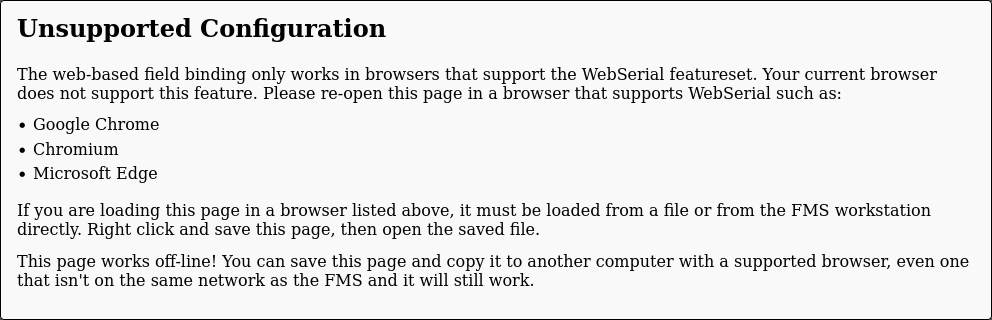
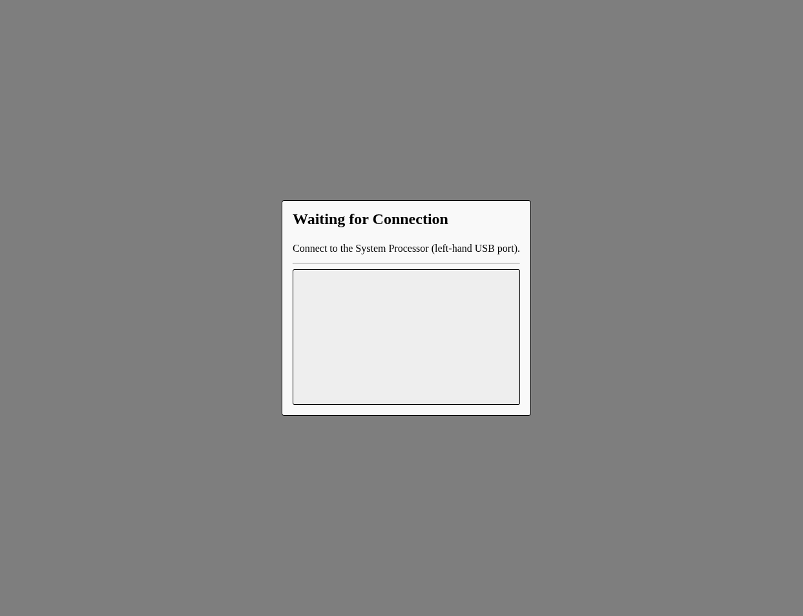
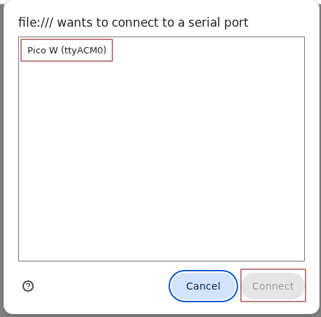
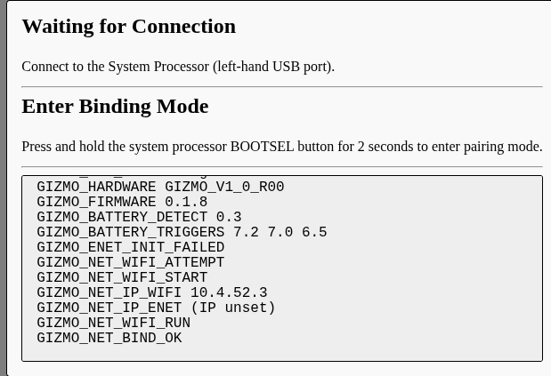
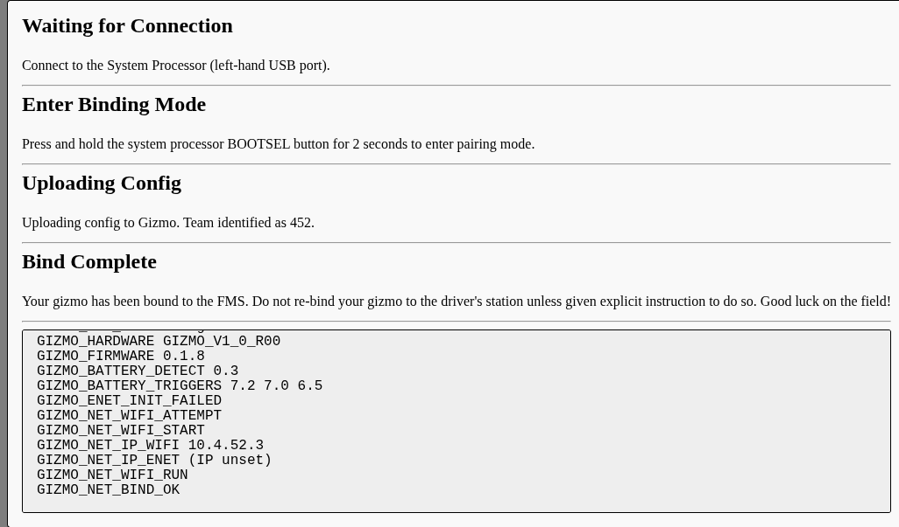

# Connecting Gizmos

Before a device powered by a Gizmo can be used on a field, it must be
bound to the FMS.  This process is extremely similar to the process of
binding a Gizmo to the Driver's Station in that it uses a USB cable to
the System Processor and a 2 second press on the System Processor's
BOOTSEL button to initiate binding.  The primary difference is that
when binding to the FMS you will be prompted to identify which team
the Gizmo being bound belongs to.

## Loading the Bind Screen

From the admin interface of the Gizmo FMS, select Operate > Bind
Gizmos.  This will open a page which does not have the menu bar.  If
opened in firefox, you will see the following screen:

The web-based Gizmo Binding workflow makes use of features that are
only available in Google Chrome and Chromium-based browsers, namely
WebSerial.  The web-based binding workflow is meant to run on a
machine that will be accessible to teams, not necessarily the FMS
Workstation.  For this reason, you can right-click and save the page
as a standalone HTML docuemnt which can then be copied using cloud
storage, email, or other network methods to the target machine.

> [!WARNING]
>
> Do not distribute this file to un-trusted entities, especially
> teams.  It contains the encryption keys for your FMS and must not be
> distributed to untrusted parties.

## Setting Up

There is a one-time setup task required to be able to use the web-bind
page.

Once you have copied the file to a computer that will be used for
binding and opened it in a Chromium-based browser, you'll have a
screen that looks like this:

Scroll down and click on "Request Port" at the bottom center of the
screen.  A dialog will open asking you to select a device to grant
access to.  Plug in any Raspberry Pi Pico W (doesn't need to even be
in a Gizmo) and select the Pico from the list:

It is only necessary to perform this procedure once.  After permission
has been granted, future Gizmos can be plugged in and the page will
handle fully automatic config binding without manual intervention.

## Binding a Gizmo

Once setup is complete, you can connect to the system processor with a
USB cable and the page will recognize that you have connected a Gizmo
for binding:

Binding will complete automatically after the BOOTSEL button is held
for 2 seconds, and the page will reset itself after the USB cable is
disconnected, or a timeout of 2 seconds.  The successful binding looks
like this:

